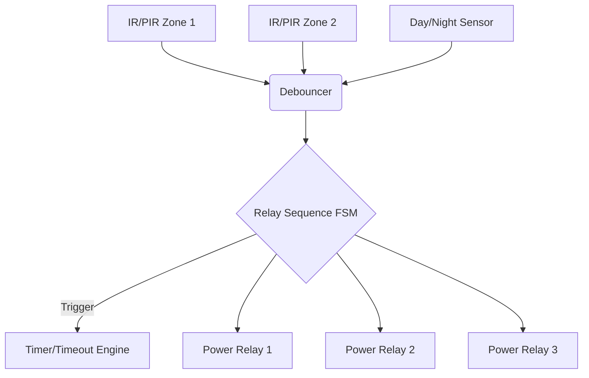
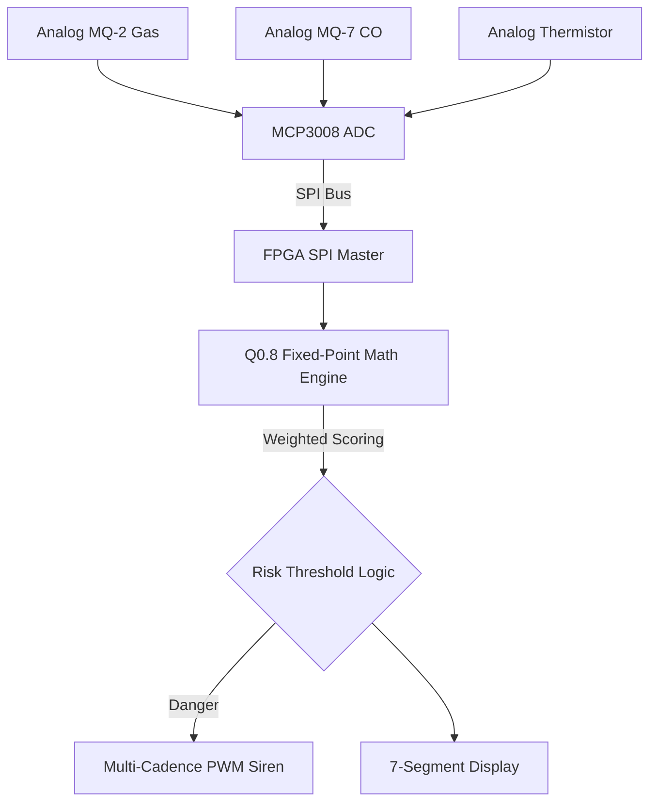
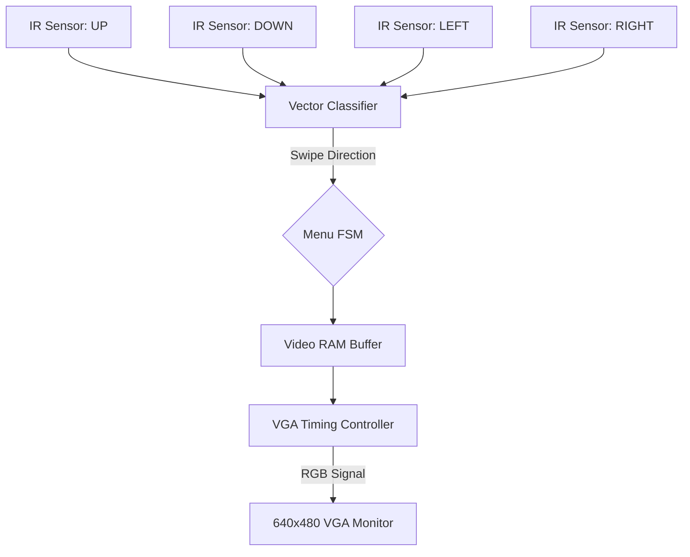
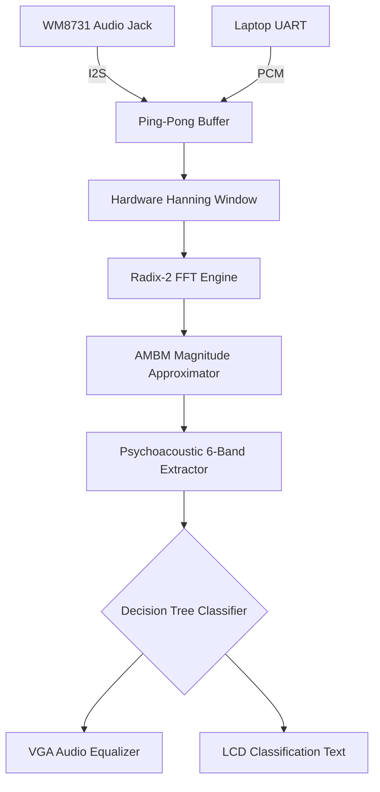

# ControlAltDelete - Final Project Report
**Team Members:** Shailesh (24BEC0655), Pradeep P (24BVD0206)
**Platform:** Terasic DE2-115 (Intel Cyclone IV EP4CE115F29C7)
**Note on Methodology:** All experiments were verified and demonstrated exclusively using 100% real physical sensor data and hardware processing, bypassing synthetic simulation modes.

---

## Experiment 1: Multi-Zone Occupancy & Energy Management Engine
### Objective
To design and implement a smart infrastructure occupancy management system that detects human presence across multiple zones and automatically sequences power relays based on environmental lighting conditions.

### System Architecture & Data Flow
Real physical IR/PIR occupancy sensors detect motion in separate zones. The signals are debounced and fed into a centralized FSM (Finite State Machine). If the Day/Night light sensor reads 'Night', the FSM triggers a cascading turn-on sequence for three power relays. If zones clear, a timeout timer safely powers down the system.

### Hardware Implementation & Results
The IR sensors are physically connected to the FPGA GPIO pins. The FPGA successfully processes the real-time sensor interrupts without a CPU, managing the sequential activation of the power relays.

[PLACEHOLDER: Insert Board Setup Photograph Here]
[PLACEHOLDER: Insert Hardware Output (LEDs/Relays) Photograph Here]

### Conclusion
The occupancy engine successfully demonstrates deterministic hardware control of smart infrastructure, strictly utilizing real-world sensor data.

---

## Experiment 2: Adaptive Multi-Sensor Fire & Combustible Gas Risk Engine
### Objective
To create a life-safety sensor fusion engine capable of detecting fire and combustible gas leaks by sampling analog MQ-2, MQ-7, and thermistor sensors via an external SPI ADC.

### System Architecture & Data Flow
Analog voltages from physical MQ sensors are digitized by an MCP3008 ADC. The FPGA acts as an SPI Master, continuously polling the ADC. The raw digital values are fed into a Fixed-Point math pipeline (Q0.8 format) which applies weighted coefficients to generate a unified 0-100% Hazard Risk Score. 

### Hardware Implementation & Results
Real gas and temperature sensors are connected to the ADC, which communicates with the FPGA via physical SPI traces. When real hazard sources (e.g., lighter gas) are introduced, the risk score spikes, triggering the hardware multi-cadence siren via PWM.

[PLACEHOLDER: Insert Board Setup Photograph Here]
[PLACEHOLDER: Insert Hardware Output (Risk Score on 7-Segment/LCD) Photograph Here]

### Conclusion
The system successfully validates the capability of the FPGA to act as a high-speed sensor fusion hub for critical analog life-safety data.

---

## Experiment 3: Smart Adaptive Agricultural Irrigation Control System
### Objective
To implement an autonomous agricultural controller that uses physical soil moisture probes and a DHT11 temperature/humidity sensor to calculate evapotranspiration compensation and safely control water pumps.

### System Architecture & Data Flow
The FPGA reads a physical Soil Moisture sensor via an ADC, and communicates with a real DHT11 sensor using a custom 1-Wire protocol engine. The moisture deficit is calculated and scaled by the current temperature/humidity to adjust watering duration dynamically.

### Hardware Implementation & Results
The system reads real soil moisture variations. When dry soil is detected, the pump relay engages. The FPGA handles 1-Wire timing constraints perfectly in pure hardware.

**Demonstration Video Link:** [https://drive.google.com/file/d/1s1GQQ905R5zOg7hUYB5DNT_u4XFKRsTm/view?usp=drivesdk](https://drive.google.com/file/d/1s1GQQ905R5zOg7hUYB5DNT_u4XFKRsTm/view?usp=drivesdk)

**Hardware Setup & Output Assets:**
- Output Video: [video_2026-10-13_15-30-47.mp4](file:///Final_Report/project%20soil/video_2026-10-13_15-30-47.mp4)
- Hardware Setup Photo: [photo_2026-10-13_15-30-19.jpg](file:///Final_Report/project%20soil/photo_2026-10-13_15-30-19.jpg)

### Conclusion
The precision timing required for the DHT11 and the analog-to-digital conversion were executed flawlessly in hardware, proving the viability of FPGA-based precision agriculture.

---

## Experiment 4: FPGA-Based Gesture-Controlled Multi-Display Menu Interface
### Objective
To develop a touchless Human-Machine Interface (HMI) using physical IR Cross sensors (or APDS-9960) to navigate a multi-tier settings menu displayed on a 640x480 VGA monitor.

### System Architecture & Data Flow
Physical hand swipes block distinct IR sensors in a specific temporal sequence. A hardware vector classifier decodes the direction (UP, DOWN, LEFT, RIGHT). These spatial vectors drive a Menu Finite State Machine, which dynamically updates a Video RAM buffer read by the 60Hz VGA timing controller.

### Hardware Implementation & Results
The hardware successfully processes real human hand gestures in real-time. The VGA monitor reacts instantly without noticeable latency, demonstrating the extreme low-latency capabilities of hardware-level GUI rendering.

[PLACEHOLDER: Insert Board Setup Photograph Here]
[PLACEHOLDER: Insert Hardware Output (VGA Monitor & Gestures) Photograph Here]

### Conclusion
The project successfully bridges spatial physical human input with a high-bandwidth video output interface without relying on a microprocessor.

---

## Experiment 5: Real-Time Audio Spectrum Analyzer & Noise Classification Engine
### Objective
To design a mixed-signal DSP engine capable of streaming real-world audio, performing a Fast Fourier Transform (FFT), and using psychoacoustic bands to classify the acoustic environment.

### System Architecture & Data Flow
Real audio is acquired via the physical 3.5mm blue Line-In jack (WM8731 Codec) or a laptop UART stream. A Ping-Pong buffer ensures zero data loss. The audio undergoes Hanning Windowing and is processed by a Radix-2 FFT Engine. The AMBM approximator extracts magnitudes, grouping them into 6 frequency bands to feed a decision tree classifier.

### Hardware Implementation & Results
When actual music or sounds are streamed into the FPGA, the VGA visualizer actively tracks the frequency magnitudes in real-time. The decision tree successfully classifies real-world sounds (e.g., categorizing low-frequency "thuds" or high-frequency tones).

[PLACEHOLDER: Insert Board Setup Photograph Here]
[PLACEHOLDER: Insert Hardware Output (VGA Audio Equalizer / LCD Text) Photograph Here]

### Conclusion
The successful real-time execution of the FFT algorithm and audio classification strictly on real hardware inputs serves as the flagship demonstration of the FPGA's immense DSP capabilities.

