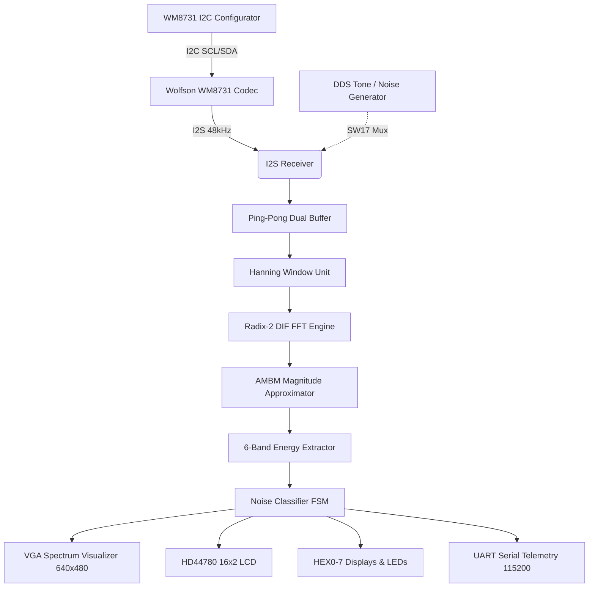

# Project 5: Real-Time Audio Spectrum Analyzer & Noise Classifier — Architecture

## 1. System Architecture Overview

The system processes incoming digital audio through a pipelined DSP transformation chain, converting time-domain PCM samples into frequency-domain spectral bins, extracting band energies, classifying the acoustic scene, and driving concurrent visual and serial outputs.

---

## 2. Pipelined DSP Mathematical Formulations

### 2.1 Hanning Window Function
To eliminate spectral leakage resulting from finite-length rectangular truncation, the $N$-point time-domain audio sequence $x[n]$ is multiplied by a symmetrical Hanning window $w[n]$:
$$w[n] = 0.5 \left(1 - \cos\left(\frac{2\pi n}{N-1}\right)\right), \quad 0 \le n < N$$
In hardware, $w[n]$ is quantized to a 16-bit unsigned fixed-point lookup table ($Q0.16$), where $1.000 = 65,535$. The windowed product is computed as:
$$x_w[n] = \frac{x[n] \times w[n]}{65536} = (x[n] \times w[n]) \gg 16$$

### 2.2 Radix-2 Decimation-in-Frequency (DIF) FFT
The Discrete Fourier Transform of the windowed sequence $x_w[n]$ is defined as:
$$X[k] = \sum_{n=0}^{N-1} x_w[n] W_N^{nk}, \quad W_N = e^{-j\frac{2\pi}{N}}$$
The Radix-2 DIF decomposition recursively divides the $N$-point sequence into $\log_2(N)$ stages. Each butterfly operation takes two complex inputs $(A, B)$ and computes:
$$A' = A + B$$
$$B' = (A - B) \cdot W_N^r$$
where twiddle factor $W_N^r = \cos\left(\frac{2\pi r}{N}\right) - j\sin\left(\frac{2\pi r}{N}\right)$ is evaluated using 16-bit fixed-point cosine/sine ROMs.

### 2.3 Alpha-Max Beta-Min (AMBM) Vector Magnitude Approximation
Standard Euclidean vector magnitude $|X[k]| = \sqrt{I[k]^2 + Q[k]^2}$ requires squaring and square-root operations. The hardware AMBM approximation estimates magnitude with $<3\%$ peak error using only bit-shifts and addition:
$$\text{Max} = \max(|I[k]|, |Q[k]|), \quad \text{Min} = \min(|I[k]|, |Q[k]|)$$
$$|X[k]| \approx \text{Max} + \frac{3}{8}\text{Min} = \text{Max} + (\text{Min} \gg 2) + (\text{Min} \gg 3)$$

---

## 3. Sub-Band Psychoacoustic Mapping

For an $N$-point FFT at sampling rate $f_s = 48\text{ kHz}$, each spectral bin index $k$ represents a frequency of:
$$f_k = \frac{k \times f_s}{N} = \frac{k \times 48000}{N}\text{ Hz}$$

The 6 frequency bands aggregate consecutive FFT bins:
| Band Index | Band Name | Nominal Frequency Range | Bins ($N=64$) | Bins ($N=256$) | Bins ($N=512$) |
|---|---|---|---|---|---|
| **Band 0** | Sub-Bass / Rumble | $0 - 250\text{ Hz}$ | $0$ | $0 - 1$ | $0 - 2$ |
| **Band 1** | Bass | $250 - 500\text{ Hz}$ | $1$ | $2 - 3$ | $3 - 5$ |
| **Band 2** | Low-Mid (Fundamental Speech) | $500 - 1000\text{ Hz}$ | $2$ | $4 - 6$ | $6 - 11$ |
| **Band 3** | Midrange (Speech Formants) | $1000 - 2500\text{ Hz}$ | $3 - 4$ | $7 - 14$ | $12 - 27$ |
| **Band 4** | High-Mid (Presence / Treble) | $2500 - 5000\text{ Hz}$ | $5 - 7$ | $15 - 28$ | $28 - 54$ |
| **Band 5** | High-Frequency / Noise | $5000 - 24000\text{ Hz}$ | $8 - 31$ | $29 - 127$ | $55 - 255$ |

---

## 4. Acoustic Scene Classification Decision Rules

The classifier evaluates normalized band energy ratios $R_i = E_i / E_{\text{total}}$ against deterministic thresholds:
1. **QUIET:** If $E_{\text{total}} < T_{\text{quiet}}$, state is `QUIET` (Class 0).
2. **SPEECH:** If $(E_2 + E_3) / E_{\text{total}} \ge 0.45$, speech formant concentration is detected $\rightarrow$ `SPEECH` (Class 1).
3. **LOW-FREQ:** If $(E_0 + E_1) / E_{\text{total}} \ge 0.50$, rumble/motor noise is dominant $\rightarrow$ `LOW-FREQ` (Class 2).
4. **HIGH-FREQ:** If $(E_4 + E_5) / E_{\text{total}} \ge 0.50$, screeching/whistle is dominant $\rightarrow$ `HIGH-FREQ` (Class 3).
5. **NOISE:** Otherwise, energy is distributed broadly across the acoustic spectrum $\rightarrow$ `NOISE` (Class 4).

---

## 5. Clocking & Power Distribution Architecture

| Clock Name | Nominal Frequency | Source | Destinations |
|---|---|---|---|
| `CLOCK_50` | $50.000\text{ MHz}$ | Onboard Crystal (`PIN_Y2`) | Reset Sync, Timers, I2C, Ping-Pong Buffers, FFT, UART |
| `VGA_CLK` | $25.000\text{ MHz}$ | Synchronous DFF Divider (/2) | ADV7123 Video DAC (`PIN_A12`), VGA Timing FSM |
| `AUD_XCK` | $12.500\text{ MHz}$ | Synchronous DFF Divider (/4) | Wolfson WM8731 Master Clock (`PIN_E1`) |
| `AUD_BCLK` | $1.536\text{ MHz}$ ($32 \times 48\text{ kHz}$) | WM8731 Audio Bit Clock | I2S Shift Register (`PIN_F2`) |
| `AUD_ADCLRCK` | $48.000\text{ kHz}$ | WM8731 Left/Right Framing | I2S Frame Sync (`PIN_E2`) |
